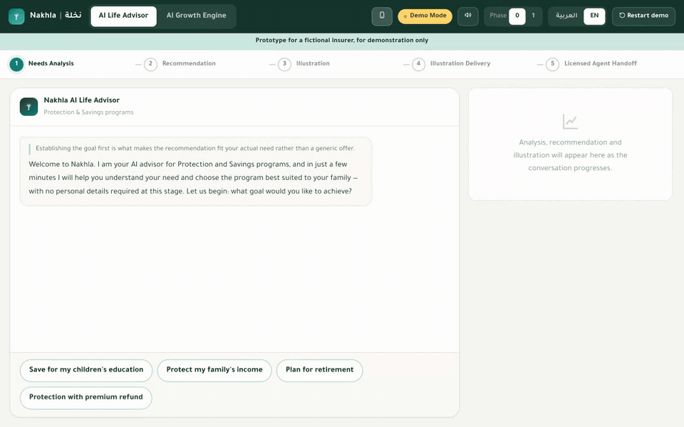
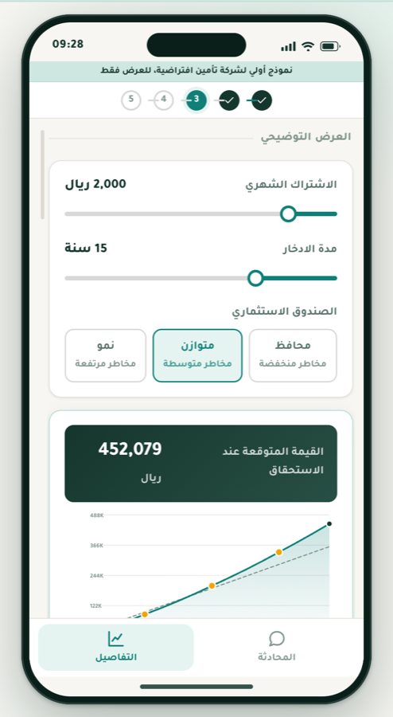
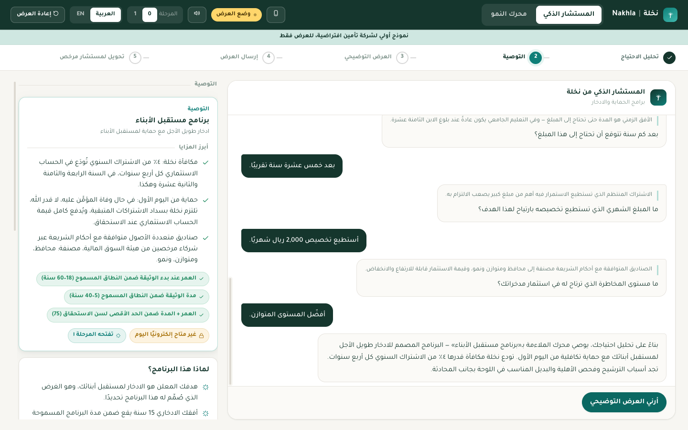
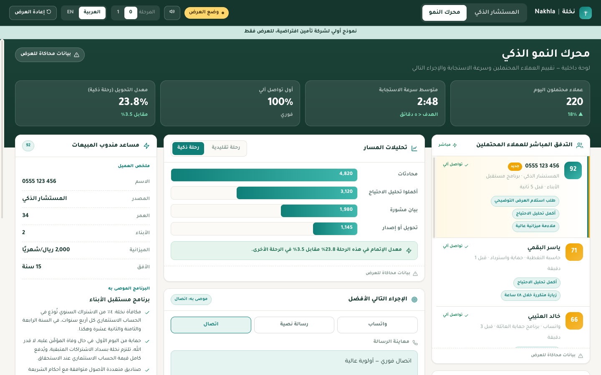
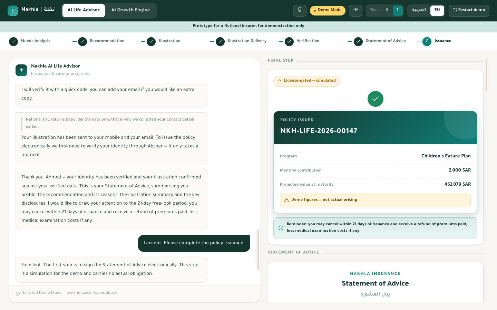

# AI Life Advisor

A working prototype of an AI-led sales journey for life insurance (protection and savings) in Saudi Arabia. A customer talks to an Arabic-first advisor, gets a product recommendation from a rules engine, adjusts a savings illustration, and leaves a mobile number only when they ask for that illustration to be sent. The lead then lands in a sales dashboard with a score, the reasons behind the score, and a call-prep card for the rep.

> Nakhla is fictional. Every product, limit, fee and figure in the prototype is invented, every number on screen is labelled as a demo figure, and it is not affiliated with any insurer.

**[Try the prototype](https://ai-life-advisor.pages.dev/)** (Arabic and English, works on a phone or a desktop browser). Every step is a quick-reply chip, so you never need to type. The code is in a private repository and is available on request.

## The problem

Life insurance is hard to sell online. Many customers don't know what a sum assured or a free-look period is, and savings products have fee schedules and fund choices that need explaining. Digital journeys tend to either sell one simple term product or end in a "request a callback" form. The lead from that form can wait hours for a call, and by then the customer has often moved on.

Regulation adds a second constraint. A suitability assessment has to drive the recommendation, and selling savings products end to end online needs a digital advisory license. Without that license, the journey has to hand over to a licensed advisor at some point.

## What I built

Two connected views that share one state, so a lead created in the first appears in the second straight away.

**AI Life Advisor**, the customer view, is Arabic-first and right-to-left, with an English toggle. It runs as a mobile app in a phone frame or as a two-column desktop workspace.

1. A conversational needs analysis: goal, age, children, income band, existing cover, horizon, monthly budget and risk comfort. Each answer is a quick-reply chip.
2. A recommendation from the suitability engine, with three key benefits, the eligibility checks, the reasons for the choice and a suitable alternative.
3. An interactive illustration. Contribution and horizon sliders, a fund choice and a projection chart with the bonus deposits marked.
4. An intent gate. "Send me the illustration" opens a delivery card that asks for a mobile number and verifies it with a simulated code.
5. One of two endings, set by a Phase toggle (see below).

**AI Growth Engine**, the internal view, is a sales dashboard. It has a live lead feed, lead scores with reasons, speed-to-lead timers, next-best-action with message previews, a call-prep copilot for the sales rep and a funnel comparison of a static journey against the AI journey.

## Product decisions

### Anonymous until the customer asks for something

The needs analysis and the full interactive illustration need no personal data. The app asks for a mobile number at one moment only, when the customer taps "Send me the illustration". The card is worded as delivery ("I'll send you your illustration") and never as registration. Verifying the number creates the lead.

The bet is that people give a number more readily when they want something sent to them than when a form stands between them and a price. That's a hypothesis, and it would be the first A/B test in a pilot.

### Rules decide, the model explains

A deterministic suitability engine picks the product, checks eligibility (age at start, policy term, and age plus term against the maximum maturity age) and returns reason codes. A separate illustration engine computes every premium and projection. The language model receives the engines' output and only phrases it. It never chooses a product, states an eligibility outcome or produces a number.

This is enforced in code. Demo Mode runs the same engines with no model at all, so the recommendation is identical with or without AI. Every recommendation can be reproduced and tested, which a compliance team will ask about first.

### Teach while asking

Each needs-analysis question comes with one line of education: why the goal comes first, what the horizon means, how fund risk works, why a free-look period protects the customer. People learn the vocabulary while they answer, without a separate explainer page.

### One journey, two endings

The Phase toggle changes how the journey ends.

- **Phase 0** works under current rules. After the illustration is sent, the customer books a slot with a licensed advisor and gets a lead reference and a promise of a call within minutes.
- **Phase 1** shows what a digital advisory license would add. It runs national ID verification, a Statement of Advice with the 21-day free-look disclosure, e-signature, payment and policy issuance, all simulated.

Phase 0 can launch without a new license, and Phase 1 shows what the license would be worth. The decision to start doesn't have to wait for regulation. In the demo, the customer is matched to a children's savings plan that can't be bought online today, so the Phase 1 ending shows an offline-only product being sold fully online.

### The lead arrives ready to work

When the customer finishes the delivery step, the lead appears at the top of the dashboard feed with a score of 92. The reasons that produced it are shown next to it: requested illustration delivery, completed needs analysis, high budget fit. The scoring function is simple and visible, so a sales manager can see why a lead ranks where it does.

The rep gets a call-prep card with the customer's profile, the recommended product, talking points taken from the same product-fact file the advisor uses, and answers to likely objections. Next-best-action picks the channel from the score: a call at 85 and above, WhatsApp from 65, SMS below that. A speed-to-lead timer starts when the lead is created, against a five-minute target.

### Labels on every number

Every premium and projection carries "Demo figures — not actual pricing", and every dashboard panel is marked "Simulated demo data". The illustration lists its assumptions under the chart: the fund growth rate, the fee schedule and the bonus schedule.

### Built to survive a live demo

Demo Mode is the default. It's a scripted conversation driven entirely by quick-reply chips, so the presenter never types. It runs with no network and no API key, and the Arabic font is bundled so the page renders correctly offline. When an API key is present, a Live AI mode sends the conversation to Claude through a small server proxy. Any error, or no reply within 15 seconds, falls back to the scripted line.

## What I'd measure in a pilot

- Needs-analysis completion rate
- Illustration-to-contact rate: the share of customers who see an illustration and then ask for it to be sent
- Speed-to-lead: minutes from contact capture to the first human touch, against a five-minute target
- Lead-to-appointment and appointment-to-policy rates, split by score band
- The share of leads for products that can't be bought online today

The funnel numbers in the dashboard are simulated. There are no real-world results yet.

## How I worked

This was a self-initiated project. I came up with the concept and made the product decisions. Those decisions include an advisor that asks for no personal data until the customer wants something sent, a rules engine that picks the product while the language model only words the answer, a line of education with every question, and two endings so the first phase can launch under current licensing.

I wrote the four documents the build follows. They are the product-fact file the advisor may not go beyond, the build spec, the five-minute demo script, and the advisor's system prompt with its guardrails. The prototype code was written by an AI coding agent (Claude Code) working from those documents. Every version was tested against the demo script in Arabic and English, on a phone and on a desktop, until both endings ran without errors.

## Stack

- React and Vite. The CSS uses logical properties, so one stylesheet serves Arabic right-to-left and English left-to-right.
- A small Node/Express server that proxies requests to the Claude API, so the API key never reaches the browser.
- The suitability and illustration engines are pure JavaScript functions with no network calls.
- It installs as a mobile web app. Arabic voice for the scripted path is optional and pre-rendered with ElevenLabs.

## Screenshots

| Arabic mobile view, illustration | Arabic desktop view, recommendation |
|---|---|
|  |  |

| Sales dashboard (Arabic) | Phase 1 ending: policy issued (English) |
|---|---|
|  |  |
